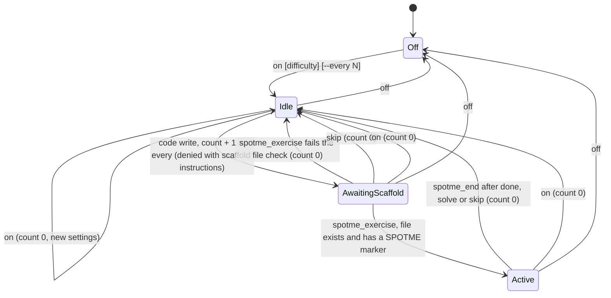

# SpotMe flow

Every adapter drives the same pure state machine in `src/engine.ts`. Hooks, the MCP server, the CLI and the in-process adapters only translate harness events into engine inputs and render the outcomes.

## Rules

- A code write is one tool call whose target has an extension in `CODE_EXTENSIONS`. A patch that touches several files counts once. Deleting a file is not a write. Shell commands that write files are not counted.
- Only `Idle` counts writes. In `AwaitingScaffold` and `Active` every write is allowed, so the scaffold write itself and the human's edits go through.
- `spotme_exercise` checks the file on disk. A missing file or a file without `SPOTME:` refuses the registration and, from `AwaitingScaffold`, drops back to `Idle(0)` so the session cannot get stuck.
- Registering the same unit and path again while `Active` is idempotent and answers with the same ready message. A different unit is refused as busy.
- `on` always resets to `Idle(0)`. `off` keeps the settings.
- `done`, `solve`, `skip` and `hint` need an exercise. Without one they are refused locally and the model is not asked to do anything. `skip` in `AwaitingScaffold` cancels the pending scaffold.
- `rep` asks for an exercise on demand, outside the counter, and is refused while one is active.
- `status` shows the pending scaffold and the active exercise.

## Where each input comes from

| Input | Hook harnesses (Droid, Claude Code, Codex, Cursor, Gemini) | OpenCode | Pi |
|-------|-------------------------------------------------------------|----------|----|
| code write | `spotme hook <harness> write` on the pre-tool hook | `tool.hook("execute.before")` in the plugin | `pi.on("tool_call")` |
| on, off, status | prompt hook runs the command and stops the turn where the harness has one; otherwise the command file asks the model to call `spotme_command` and relay the text | command file, then `spotme_command` over MCP | `registerCommand`, answered in the UI |
| done, solve, skip, hint, rep | command file or raw prompt reaches the model, which calls `spotme_command` and follows the returned instructions | same | `registerCommand`, then `sendUserMessage` with the instructions |
| spotme_exercise, spotme_status, spotme_end | MCP server `spotme mcp` | MCP server `spotme mcp` | `registerTool` |

## State

State is one JSON document per project at `<state dir>/<sha256 of the canonical project root>.json`. The canonical root is the realpath of the nearest ancestor holding `.git`. Writers take an exclusive lock file next to it (`open` with `wx`); a lock whose owner process is gone on this host, or that is older than 10 seconds, is moved aside and removed. A writer that cannot get the lock within 2 seconds lets the write through rather than blocking the agent. Readers never lock.
